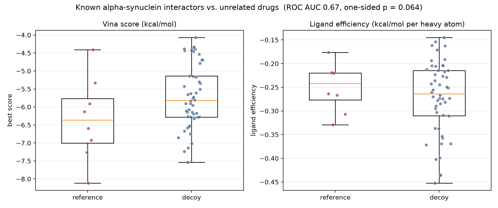
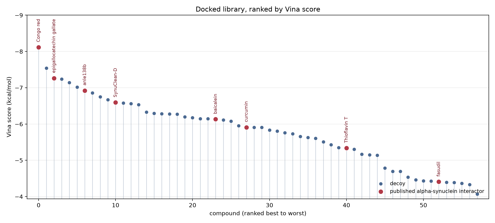
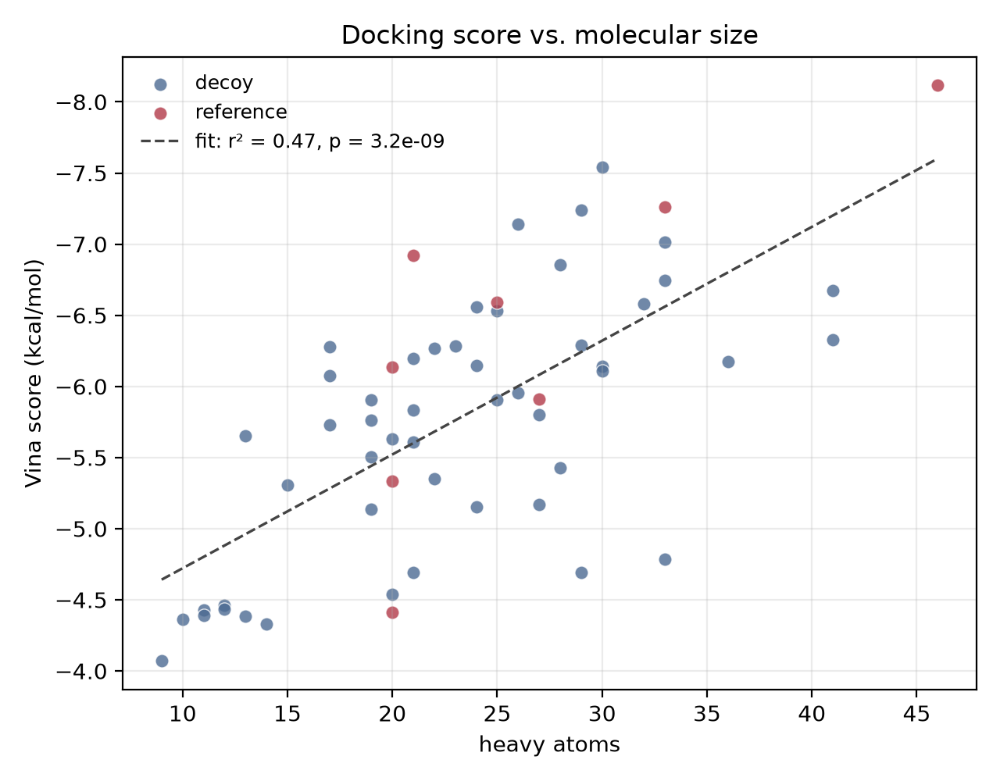
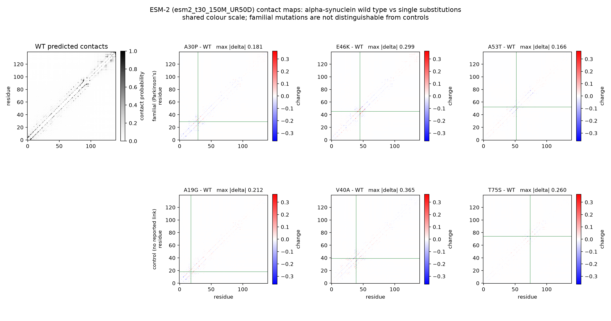

# Docking small molecules against an alpha-synuclein fibril

A small, self-contained computational experiment on alpha-synuclein, the protein
that aggregates into fibrils in Parkinson's disease. It asks one question that
can actually be answered with the tools at hand:

> Can a standard AutoDock Vina setup, aimed at a binding site on alpha-synuclein
> that was **observed experimentally by cryo-EM**, tell published
> alpha-synuclein binders apart from unrelated approved drugs?

**The answer is no.** That is the result, and this repository is built to show
how it was reached rather than to dress it up.

The whole thing runs end to end on a laptop in about 50 minutes.

---

## The headline numbers

| Check | Result | What it means |
|---|---|---|
| **Redocking control** (apo receptor, the one used for the screen) | top-ranked pose **9.43 Å** from the crystal pose; best of 9 poses 6.25 Å | Fails the conventional 2 Å mark badly. The setup cannot rebuild a pose that was already measured. |
| **Redocking control** (neighbouring dye molecules kept) | top-ranked pose **8.04 Å**; best of 9 poses **2.79 Å** (ranked 7th) | A near-native pose is *generated*, but Vina's scoring does not rank it first. |
| **Known binders vs. decoys**, by Vina score | ROC AUC **0.67**, one-sided p = 0.064 | A weak trend, not significant at the 0.05 level with 8 references. |
| **Known binders vs. decoys**, by ligand efficiency | ROC AUC **0.44**, p = 0.73 | The trend **disappears** once molecular size is accounted for. |
| **Score vs. molecular size** | r² = **0.47**, p = 3e-09 | Nearly half the variance in the score is explained by how many atoms a molecule has. |
| **Thioflavin T**, the compound resolved bound in this exact site | ranks **41st of 58** | The one compound known to bind here scores worse than most unrelated drugs. |

The single most informative line is the last one. Thioflavin T is in the
structure, in this site, in the deposited coordinates. The protocol ranks it
below risperidone, tadalafil and prednisone.



The apparent enrichment on raw score (left) does not survive normalising for
molecular size (right).

Ligand efficiency has a bias of its own, in the opposite direction: dividing by
heavy-atom count over-rewards very small molecules, and the top of that ranking
is metformin at 9 heavy atoms. So the two columns bracket the problem rather
than settling it — raw score favours large molecules, efficiency favours small
ones, and the reference compounds are not consistently at the top of either.
Neither metric is the arbiter on its own; what matters is that the apparent
signal does not survive a change of normalisation.

---

## Why this receptor and this site

Alpha-synuclein has no classical drug-binding pocket, so the tempting move is to
pick any fibril structure and choose a plausible-looking groove. A site chosen
that way cannot be checked. This uses **PDB [7YNM](https://www.rcsb.org/structure/7YNM)**
instead: a cryo-EM alpha-synuclein fibril with **Thioflavin T resolved in its
binding channel** — eight copies of it, stacked in two columns along the fibril
axis, spaced ~4.8 Å apart.

Picking a structure that already contains a ligand buys two things:

1. The docking box sits on a site someone measured, not on a guess.
2. There is a pose to check the protocol against — the redocking control above.

The box is built around the central dye copy and spans the groove lined by
**Tyr39, Glu46, Lys80, Thr81 and Val82**.

### The fibril symmetry problem

An amyloid fibril stacks identical subunits every ~4.8 Å, so the binding site
repeats along the fibril axis. **Three symmetry-equivalent copies of the site
fall inside the docking box**, and no practical box avoids this.

A pose that lands one layer over is the *same* binding mode, so scoring it
against one arbitrary copy reports a large RMSD for a correct answer. Every
pose here is therefore scored against **all eight deposited copies**, taking the
minimum. This was not a cosmetic choice: it was the first explanation tested for
the failing control, and it is worth stating that it did **not** rescue it — the
pose is genuinely ~8–9 Å away from every copy.

### Thioflavin T binds as a stack

The second explanation tested: Thioflavin T stacks along the fibril, so part of
each site's wall is built from its own neighbours, not from protein. Stripping
all eight copies deletes real binding surface.

So the control is run against two receptors:

- **apo** — every dye molecule removed. This is what the screen uses, because a
  drug would have to bind a fibril with no dye in it.
- **holo** — neighbours kept, one slot emptied.

Keeping the neighbours improves the score by ~3.5 kcal/mol and brings the best
generated pose to 2.79 Å. It still does not put that pose first. Both
explanations were real effects; neither fixed the problem.

---

## The library

58 compounds, every SMILES resolved from **PubChem by name** and checked against
a molecular formula recorded in the source, so a bad lookup raises instead of
quietly docking the wrong molecule.

**8 reference compounds** with published evidence of binding alpha-synuclein or
altering its aggregation — Thioflavin T, anle138b, EGCG, SynuClean-D, curcumin,
baicalein, fasudil and Congo red.

**50 decoys**: approved drugs from unrelated therapeutic areas.

Lipinski rule-of-five descriptors are computed and reported per compound, but
nothing is excluded on them — 4 of the 58 violate more than one rule, and they
are left in so the table shows what a filter would have removed. Descriptors are
computed on the desalted molecule, the same fragment that is docked, so a
counterion cannot inflate the heavy-atom count that ligand efficiency divides by.

Where the references actually landed:

| Rank (of 58) | Compound | Vina score | Ligand efficiency |
|---:|---|---:|---:|
| 1 | Congo red | −8.12 | −0.176 |
| 3 | epigallocatechin gallate | −7.26 | −0.220 |
| 7 | anle138b | −6.92 | −0.330 |
| 11 | SynuClean-D | −6.59 | −0.264 |
| 24 | baicalein | −6.13 | −0.307 |
| 28 | curcumin | −5.91 | −0.219 |
| 41 | **Thioflavin T** | −5.34 | −0.267 |
| 53 | fasudil | −4.41 | −0.221 |

Congo red tops the table at 46 heavy atoms — the largest molecule in the set.
Given r² = 0.47 between score and size, that is the expected position for the
biggest molecule, not evidence of binding.




---

## Side analysis: ESM-2 contact maps for the familial mutants

Independent of the docking. Does a protein language model predict different
residue contacts for **A30P, E46K and A53T**, the point mutations that cause
familial Parkinson's disease — *more* than it does for substitutions that cause
nothing?

Sequence is UniProt **P37840** (140 aa), verified byte-for-byte against the
UniProt record, with each mutation site checked before substitution.

A bare "the maps barely change" would mean nothing — *any* single substitution
in a 140-residue protein barely changes them. So three **control
substitutions** with no reported Parkinson's link are run alongside, as a
baseline for how much an arbitrary mutation moves the map.

| | Variant | Map correlation to WT | Embedding cosine | Largest single change | Frobenius norm of change |
|---|---|---:|---:|---:|---:|
| familial | A30P | 0.9969 | 0.99973 | 0.181 | 0.766 |
| familial | E46K | 0.9949 | 0.99939 | 0.299 | 0.986 |
| familial | A53T | 0.9983 | 0.99988 | 0.166 | 0.571 |
| control | A19G | 0.9976 | 0.99987 | 0.212 | 0.687 |
| control | V40A | 0.9961 | 0.99991 | **0.365** | 0.854 |
| control | T75S | 0.9987 | 0.99994 | 0.260 | 0.495 |

**Median change — familial 0.766, control 0.687.** Effectively the same. And
the single largest perturbation in the whole set belongs to **V40A, a control**,
not to any disease mutation.

**A clear negative.** ESM-2 at this scale does not distinguish the mutations
that cause familial Parkinson's disease from arbitrary single substitutions.
Without the controls this would have been reported as "the familial mutations
barely perturb the map", which sounds like a finding and is not one.

A caveat on the correlation and cosine columns: both are computed over the
whole matrix or a mean-pooled embedding, so they are dominated by what the
variants share with wild type and sit near 1 by construction. They are reported
for completeness, but the familial-vs-control comparison is what carries the
argument.

One sanity check does pass: the wild-type map is dominated by near-diagonal
contacts with almost no long-range structure, which is the correct behaviour for
an intrinsically disordered protein.



Run with ESM-2 **150M**. The 650M weights are 2.6 GB; 150M is 0.59 GB and
sufficient for a qualitative comparison. Change `MODEL_NAME` in
`src/esm_mutants.py` to use the larger model.

---

## What this does not show

- **Not binding affinities.** A Vina score is a scoring-function output that
  happens to carry kcal/mol units. It is not a measured free energy and does not
  convert to one. No number here is a Kd or an IC50.
- **No experimental validation.** Nothing was tested against protein. No
  compound here has been shown to do anything to alpha-synuclein by this work.
- **The decoys are not confirmed non-binders.** They are drugs with no published
  alpha-synuclein interaction, which is not the same as a measured negative.
  Some may well bind.
- **Rigid receptor, no solvent.** No explicit water, no ions, no protein
  flexibility, no entropy beyond the scoring function's approximation.
- **One polymorph.** Alpha-synuclein fibrils are polymorphic. A different
  polymorph gives a different site and different numbers.
- **8 references is a small sample.** The confidence interval on an AUC from 8
  positives is wide, which is exactly why the p-value of 0.064 is reported
  rather than described as a trend toward significance.
- **Neither scoring column is unbiased.** Raw Vina score rises with molecular
  size; ligand efficiency over-corrects and favours very small molecules. They
  are reported together because they fail in opposite directions, not because
  either one is the right answer.

Given that the redocking control fails, the ranking results should be read as
**evidence about this protocol**, not as evidence about these compounds.

---

## Reproducing it

Two environments, because PyTorch ships its own OpenMP runtime that aborts at
import when the conda `libomp` used by RDKit and Vina is already loaded
(`OMP: Error #15`). Separating them avoids the unsafe `KMP_DUPLICATE_LIB_OK`
override.

```bash
# docking
conda env create -f environment.yml
conda activate asyn
python test_pipeline.py      # 8 self-checks, a few seconds
python run_pipeline.py       # ~50 min: downloads 7YNM, controls, 58 docks
```

```bash
# ESM-2 side analysis
conda env create -f environment-esm.yml
conda activate asyn-esm
python src/esm_mutants.py
```

`python run_pipeline.py --reanalyze` recomputes descriptors, statistics and
figures from the saved docking scores without redocking — useful after a fix to
the analysis code, since the 50 minutes is all in the docking.

Nothing is committed that should not be: the PDB file and the prepared receptor
are downloaded at run time into `data/`, which is gitignored. No model weights.

### Layout

```
src/receptor.py      fetch 7YNM, find the ligand site, build the box and receptors
src/library.py       PubChem resolution with formula checking, Lipinski descriptors
src/dock.py          3-D embedding, PDBQT via Meeko, Vina, symmetry-aware pose RMSD
src/analyze.py       ranking statistics, enrichment, figures
src/esm_mutants.py   ESM-2 contact maps for WT vs familial mutants
run_pipeline.py      the whole docking run
test_pipeline.py     self-checks for the logic that could fail silently
notebooks/results.ipynb   walkthrough of the saved results
results/             docking_results.csv, enrichment.csv, summary.json, figures
notebooks/archive/   the original 2024 notebooks, none of which ran
```

`results/summary.json` records the receptor, box, every docking parameter, the
random seeds and the per-pose RMSDs, so the numbers above can be traced back.

### The self-checks

`test_pipeline.py` covers the logic where a bug would produce plausible-looking
numbers rather than an error: the symmetry-aware RMSD (a pose must score 0
against itself), the direction of the ranking statistics (more negative scores
must give AUC > 0.5), salt stripping, ligand efficiency, enrichment arithmetic,
the Lipinski filter, and the guard that rejects a mutation applied to the wrong
residue.

---

## History

This started as five exploratory notebooks in 2024. **None of them ever ran end
to end** — the Vina install failed on macOS arm64, the ESM calls imported the
wrong `esm` package, ESM3 was gated behind a 401, and one model was trained on
docking scores as labels, so it could only have learned to imitate Vina.

They are kept in [`notebooks/archive/`](notebooks/archive/) with
[a note on exactly what was broken in each](notebooks/archive/README.md). Nothing
in them should be read as a result.
